  <!-- BANNER SUPERIOR -->
  <!-- Puedes reemplazar esta URL por una imagen personalizada (ej. assets/banner.png) -->
  

  <!-- BADGES DE REDES SOCIALES -->
  

    
    &nbsp;
    
    &nbsp;
    
  

  <!-- SALUDO Y BIOGRAFÍA -->
  <h1>Hi there 👋, &lt; devs /&gt;</h1>

  

    My name is <b>Jaime Fabián Cortés Vega</b>, a passionate developer from <b>Mexico</b>.
     
    My main areas of interest are <b>Data Analysis</b>, <b>Machine Learning</b>, and <b>Software Development</b>.
     
    Constantly learning and building solutions with modern technologies and clean architectures.
  

   

  <!-- TECH STACK -->
  <h2>Tech Stack</h2>
  

  

    
     
    
  

   

  <!-- ACTIVITY & STATISTICS -->
  <h2>Activity &amp; Stats</h2>
  

    
  

  

    
  

  

    
  

  

    
  

   

